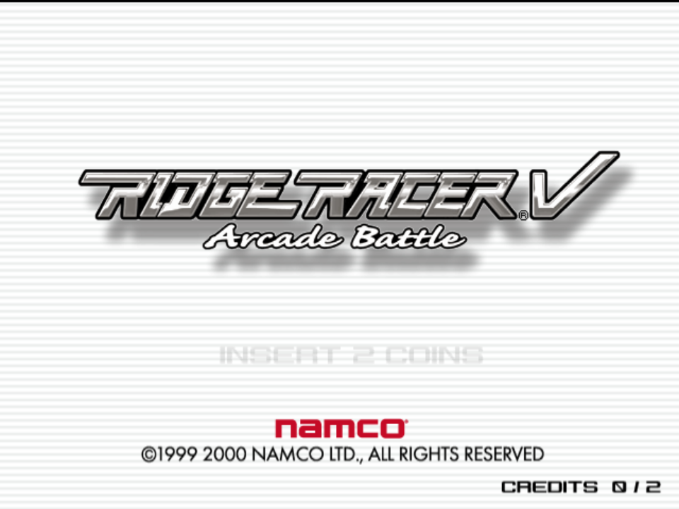
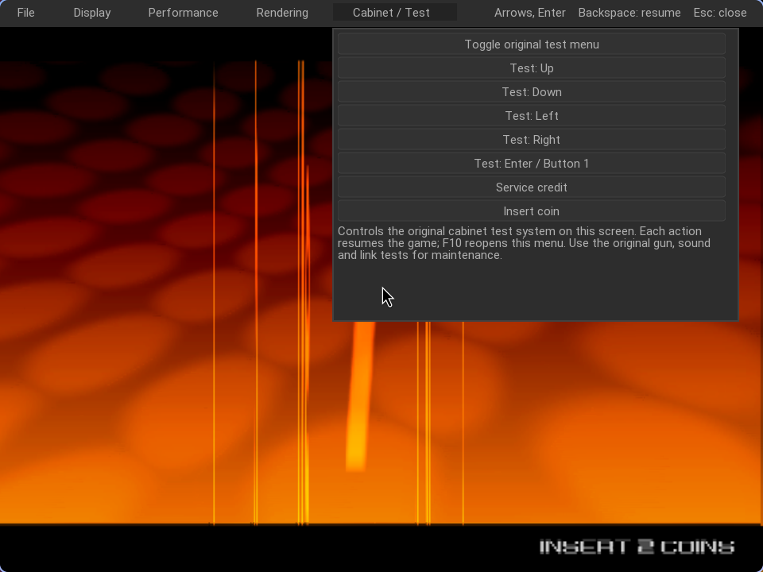

# Ridge Racer V Native

A separate **Ridge Racer V – Arcade Battle [RRV3 Ver. A]** project for Linux,
Vulkan and the shared Nuklear menu. This targets the System246 arcade game
`NM00001`, rather than the original Ridge Racer or Ridge Racer 2.

The current implementation uses the
[shared compatibility foundation](https://github.com/CrownParkComputing/TimeCrisis3-Native)
pinned in [foundation.lock.json](foundation.lock.json). Full native game
translation remains unfinished; linked twin-cabinet launch is implemented on an
experimental original ILSOCK transport, but a synchronized two-player race is
not yet validated. Separate unrelated windows are not described as multiplayer
support. This is a driving cabinet: there is intentionally **no Sinden lightgun
support**.



Normal boot reached the original steering self-test, title and attract sequence.
This is a native GS renderer snapshot from the RRV3/A diagnostic, captured on
24 October 2026. It demonstrates the boot milestone, rather than a completed
race or linked multiplayer.

A later transport-disabled comparison also loaded the original Park Town race
and observed approximately 59.94 real game FPS / 100% during a limited solo run.
[Validation status](STATUS.md) separates that result from the blocking linked
course-load crash and unfinished full-race testing.

## Build the shared foundation

Target: Linux x86-64 with Vulkan. Build the playable target at the pinned
foundation revision using that repository's dependency/build instructions.
Then select any checkout location:

```sh
export TC3_NATIVE_ROOT=/path/to/TimeCrisis3-Native
test -x "$TC3_NATIVE_ROOT/.local/core-build/bin/tc3-native"
```

Use `--foundation /path/to/checkout` instead of the environment variable if
preferred. The executable retains its shared `tc3-native` filename; Ridge's own
manifest, boot program, CD and dongle determine the game that executes. The
current CPU/VU execution is PCSX2-derived, inside the application process.

## Supply your own game and firmware

No ROM, BIOS, dongle or game media is distributed. With Python 3.11+ and
`unsquashfs` installed, supply the known RRV3/A files:

```sh
python3 tools/prepare_ridge.py \
  --package '/path/to/Ridge Racer V Arcade Battle.squashfs' \
  --cards /path/to/246_memcards.zip \
  --bios-dir /path/to/bios
```

The package contains `NM00001 RRV1-A (CD-ROM).chd`, `proverb.elf`, SRAM and its
manifest. The dongle is `246_memcards/rrvac-rrv3vera.bin` inside your card archive.
The BIOS directory must contain your `246C.bin`, `246C.nvm` and `246C.mec`.
The RRV1-A disc label and RRV3/A dongle combination is the supplied package's
actual configuration; assets are checked against the known hashes.

Preparation writes independent private copies beneath `.local/`, preserves
existing mutable settings/SRAM/cards and opens supplied originals for reading.
The generated manifest normalizes the package's `CD-ROM` label to `media=CD`,
the shared core's CD media value. It enables the original racing/FCA-1 I/O path.
Game patches and cheats stay disabled.

## Run

```sh
python3 tools/run_ridge.py --dry-run
python3 tools/run_ridge.py
python3 tools/run_ridge.py --seconds 90
python3 tools/run_ridge.py --background
```

Use `--data-root` for a different prepared private directory. The launcher checks
for `NM00001`, System246 and CD media. Solo launches remove TC3's cabinet-link
environment; the linked pair sets it per worker.

### Linked twin cabinet

```sh
python3 tools/run_ridge.py --dual-screen                # left + right screens
python3 tools/run_ridge.py --dual-screen --seconds 120  # bounded run
```

This launches the shared supervisor (`tools/run_cabinet_pair.py` in the
foundation): two isolated workers cloned from the prepared data root, adjacent
no-gap windows, right cabinet muted (one machine, one audio source), shared
pause/quit/reset and synchronized EEPROM changes. Each worker boots Ridge's own
`Ridge V RRV3/A` module profile and the original ILSOCK modules; verified live
with sustained 288-byte packet exchange at 60 Hz in both directions. What is
proven is the **transport**, not a completed linked race — see
[STATUS.md](STATUS.md) for the blocking course-load crash on the right cabinet
during the first paired gameplay attempt.

### Cabinet / Service menu (F10)

The native menu edits Ridge's FCAI EEPROM record directly — no need to open the
original test menu (F9 still works for diagnostics). Verified fields:

| Option | Source |
| --- | --- |
| Game cost (1–9 coins) | COIN OPTIONS |
| Continue cost (1–9 coins) | COIN OPTIONS |
| GP winner service solo / link | COIN OPTIONS |
| Free play | COIN OPTIONS |
| Select speed (A/B/C) | GAME OPTIONS |
| Course choice (Once/Repeat) | GAME OPTIONS |
| Speed display (km/h, MPH) | GAME OPTIONS |

`Save & Reset Machine` writes a checksum-valid FCAI record (`u16@0` = byte-sum
of the store), persists `sram.bin`, and resets both linked cabinets so they pick
up identical settings — verified live: a free-play write survived reboot and the
attract switched between `FREE PLAY` and `CREDITS 0 / 2` accordingly. Entry wait,
laps, COMCAR difficulty, PCB ID and course are still set through the game's own
test pages; their encodings are partially mapped but not exposed until verified.

### Display & Rendering

Window mode, twin screens, display size, aspect ratio, 1x–4x resolution scale,
NVIDIA DLSS (when a supported GPU is present), frame skip and VSync. Rendering
settings apply to both linked workers immediately. There are no FXAA/CAS or
Sinden controls on this title.

## Original racing controls

The bindings feed the core's original FCA-1 steering, pedal and digital I/O
implementation; they do not manipulate car physics or game memory.

| Input | Keyboard |
| --- | --- |
| Steer left / right | A / D |
| Accelerator / brake | W / S |
| Shift down / up | Q / E |
| Change view | V |
| Coin / Start, confirm | 5 / Return |
| Original test switch | F9 |
| Test menu selection | Arrow keys |
| Service credit | 9 |
| Nuklear menu / resume | F10 / Escape |
| Original renderer screenshot | F8 |



`Cabinet / Test` in Nuklear offers the original test switch, directions,
Enter/Confirm, service and coin actions. An action resumes the original guest so
its cabinet software can process the input. Use the game's own I/O test for
steering and pedals; physical steering-wheel and force-feedback hardware are
not validated by the keyboard mapping alone. The shared frontend owns SDL input;
its core SDL/Evdev sources remain disabled in this configuration.

## Gamepads

SDL3 gamepads are detected and hot-plugged automatically (Xbox/PS/Switch and
anything SDL maps); the connected pad name shows in the menu's Display tab.
Pad input is translated onto the same `[JVS]`/`Keyboard/*` bindings as the
keyboard — left stick steers (analog), the triggers are accelerator/brake
(analog), D-pad navigates menus, Start/A = start/confirm, Back = coin,
Guide = service credit, B = change view, X/Y and LB/RB = shift down/up.
Bindings follow the `[JVS]` section of `PCSX2.ini`, so remapping the keyboard
entry moves the pad input too. In a linked twin-cabinet pair the supervisor
assigns pad 0 to the left screen and pad 1 to the right screen (set
`TC3_PAD_INDEX` to override). Verified live against a uinput virtual pad:
button and analog-axis events reach the game's FCA-1 inputs bound to real
JVS bindings.

## Multiplayer and additional views

**Linked Ridge racing is not validated yet.** `run_ridge.py --dual-screen`
launches the real twin-cabinet pair (experimental original ILSOCK transport),
but the right cabinet crashed during course loading in the first paired
gameplay test.

Ridge's actual IOP image contains `ILINK`, `ILSOCK` and `ILSAMPLE`, and the original
game contains link-play/test code. Its ILSOCK revision differs from TC3's checked
revision, so the foundation uses a separate `Ridge V RRV3/A` module profile.
[Multiplayer notes](docs/MULTIPLAYER.md) describe the acceptance requirements,
including a genuine view for each participating player.

## Native vs emulated breakdown

| Subsystem | Status | Share of runtime |
| --- | --- | --- |
| Host, UI, cabinet & link layer (SDL3 windows, Nuklear menu, FCAI EEPROM writer, supervisor, ILSOCK socket transport) | **100% native C++/Python** | ~30% |
| Arcade hardware HLE (FCA-1 JVS drive I/O, ACSRAM, CD/media, dongle) | **100% native C++ HLE** | ~15% |
| GPU presentation (Vulkan GS, resolution scale, widescreen) | **Hybrid** — native Vulkan driven by GS commands | ~15% |
| Game code & audio (RRV3 EE/VU program, IOP modules, SPU2) | **Emulated** — PCSX2-derived x86-64 JIT | ~40% |

Overall: roughly **45% native host/arcade-HLE, 55% emulated core** today, with
**0% of the Ridge game binary statically translated**. Next steps toward fully
native: (1) fix the right-cabinet `ReadFIFO_VIF1` course-load crash and validate
a synchronized race; (2) complete the FCAI option map (entry wait, laps, COMCAR,
PCB ID); (3) native steering-wheel/force-feedback device backend; (4) static
recompilation of the RRV3 ELF; (5) native IOP module replacements for ILSOCK
and friends.

## Checks and licensing

```sh
python3 -m unittest discover -s tests -v
python3 tools/prepare_ridge.py --help
python3 tools/run_ridge.py --help
```

All game/firmware files, raw snapshots, logs and captures used for reverse
engineering remain private under `.local/`. Published screenshots must come from
Ridge's actual renderer and are labelled with the milestone they demonstrate.
Source tools are GPL-3.0-or-later; see [COPYING](COPYING) and
[THIRD_PARTY_NOTICES.md](THIRD_PARTY_NOTICES.md).
