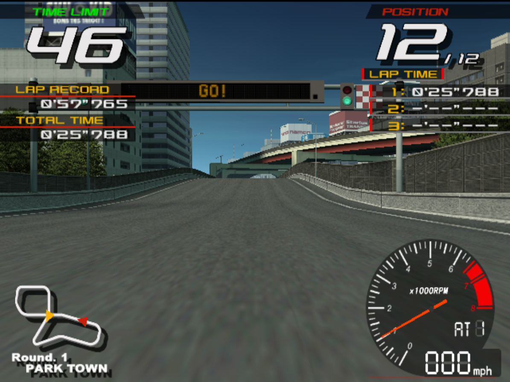

# Ridge Racer V status

## Target identity

The supplied package is **Ridge Racer V Arcade Battle [RRV3 Ver. A]**, game ID
`NM00001`, System246. Its RRV1-A CD CHD and RRV3/A dongle are the package's actual
combination. The shared core's GameIndex identifies boot program `START` and
`driving` input. The original dongle and IOP image have been inventoried locally.

The prepared configuration uses CD media and the original FCA-1 I/O path:
steering, accelerator, brake, shift up/down, view, start/confirm, coin, service
and test. Source inspection establishes these bindings; it does not establish
complete driving or physical wheel/force-feedback correctness.

## Runtime milestone

A bounded 90-second normal boot passed the original steering self-test and
reached the title and attract sequence. The proof run advanced guest fields
from 0 to 5271, exited with status 0 and logged normal VM shutdown. Real game
rate samples of approximately 59.94 FPS occurred during the diagnostic; the
attract movie also reports approximately 29.97 FPS. These observations do not
establish full-speed racing or complete gameplay.

F8 requested three images directly from Ridge's GS renderer. The title and
self-test captures in `docs/screenshots/` therefore have verified pixel origin.
The raised Ridge window was also captured with the actual shared Nuklear
Cabinet / Test menu open. F10/Tab/Escape navigation was exercised and resumed
normal guest execution. No coin, start, steering, accelerator or brake input was
sent during this proof run; actual driving and wheel calibration remain
unvalidated. The first diagnostic also booted/exited normally, but its screenshot
helper timed out before locating the desktop window; only the second proof run's
verified images are published.

## Shared foundation

The Linux/Vulkan/Nuklear compatibility foundation is pinned in
[foundation.lock.json](foundation.lock.json). It executes original game CPU/VU
programs in process using PCSX2-derived components. Full native translation,
Android and touch/racing hardware support remain separate unfinished work.
The source tools do not contain original game or BIOS data.

## Cabinet service options (native)

The shared F10 menu's `Cabinet / Service` tab edits Ridge's FCAI EEPROM record
directly. Verified on the live game: writing option bytes plus the record's
`u16` byte-sum checksum to `sram.bin` is accepted on boot (attract toggles
between `FREE PLAY` and `CREDITS`), and an incorrect checksum makes the game
restore factory defaults — confirmed empirically before implementation.
Exposed fields: game cost, continue cost, GP winner service solo/link, free
play, select speed, course choice and speed display. `Save & Reset Machine`
persists the image and resets both linked workers together.

## Linked multiplayer

Transport implemented and live-tested; gameplay remains blocked. A separate
Ridge ILSOCK profile in the shared foundation (`Ridge V RRV3/A`, verified at
module base `0x77230`) admitted both original modules. Both cabinets exchanged
over 10,000 original 288-byte packets, and read-only inspection confirmed
original connection state 3 on both. The original service menu displayed
`LINK ON`. The right cabinet's PCB ID was changed to `2 (RIGHT)` through the
original service menu, which then displayed `LINK AS 2 (RIGHT)`. No guest
memory or game code was patched.

`tools/run_ridge.py --dual-screen` now launches the real supervisor pair:
per-role data-root clones, adjacent no-gap windows, right cabinet muted,
shared pause/quit/reset and EEPROM sync. A 120-second paired run on
25 October 2026 showed sustained bidirectional link traffic (~2,400 frames of
288-byte packets each direction), synchronized state sync and clean exit on
both workers.

Both cabinets were credited and reached original car/course selection with a
green Link indicator. The left entered Park Town and displayed a car marked
`1P`; the right aborted during course loading with the shared core's
`ReadFIFO_VIF1` assertion, `FQC = 0 on VIF FIFO READ!`. Its preserved crash dump
places the original game in a very large `memcpy` whose source reached the FIFO
address. That finding requires diagnosing the source resource/header state;
removing the assertion would not establish correctness. The supervisor stopped
the remaining cabinet normally. A synchronized two-player race has therefore
not been validated. See
[docs/MULTIPLAYER.md](docs/MULTIPLAYER.md).

The same right cabinet was subsequently cold-booted with its saved PCB ID and
SRAM, with all cabinet transport environment removed. It successfully loaded
Park Town, continued through the limited solo-race observation at approximately
59.94 real game FPS / 100%, and exited normally at the 240-second bound. Its
original fixed resource buffer contained a valid three-slice header during live
inspection. This controls for the original PCB ID2 setting and demonstrates
that the paired failure is not an inevitable solo course-load failure. It does
not isolate transport causation from timing or changes made to the link-side
configuration during the first paired run. No complete lap or race has yet been
validated.

## Full-native recompilation spike

The separate static-recompilation experiment
([docs/RECOMP_SPIKE.md](docs/RECOMP_SPIKE.md)) now runs the decrypted game
binary as host C++ — no EE/IOP virtual machine on the executed paths. Verified
milestones: all 24 real ACIOPRP IRX modules load and start serially; the ATAPI
DVD-ROM is emulated at the ACATA register level and streams the real disc into
a 128 MB ACRAM cache with verify; the FCA-1 I/O frame and the V257 drive-board
UART (`C01` status stream) satisfy the steering self-test; sound init runs and
`kt_cd2arcram` completes. The recompiled binary renders the real **Ridge Racer
V Arcade Battle title screen ("INSERT 2 COINS")** and enters its attract loop
with BGM started.

Update: the i.Link firmware chain (ILINK/ILSOCK/ILSAMPLE) is now replaced by
a **native socket service** — HLE SIF servers for all twelve `sceILsock` RPCs
plus real loopback-UDP transport — and two `ps2run` processes verifiably
exchange real 288-byte game datagrams. ACSRAM is file-backed with valid
checksums (FREE PLAY and cabinet role persist). Measured: under 0.2% of
executed guest instructions run on the IOP interpreter — everything else is
native. Remaining gaps: finishing linked-race negotiation, SPU2 host audio,
VU1-program invocation, and native services for the rest of the IOP firmware
(CDVD/FILEIO/MCMAN/ACIOPRP drivers).
